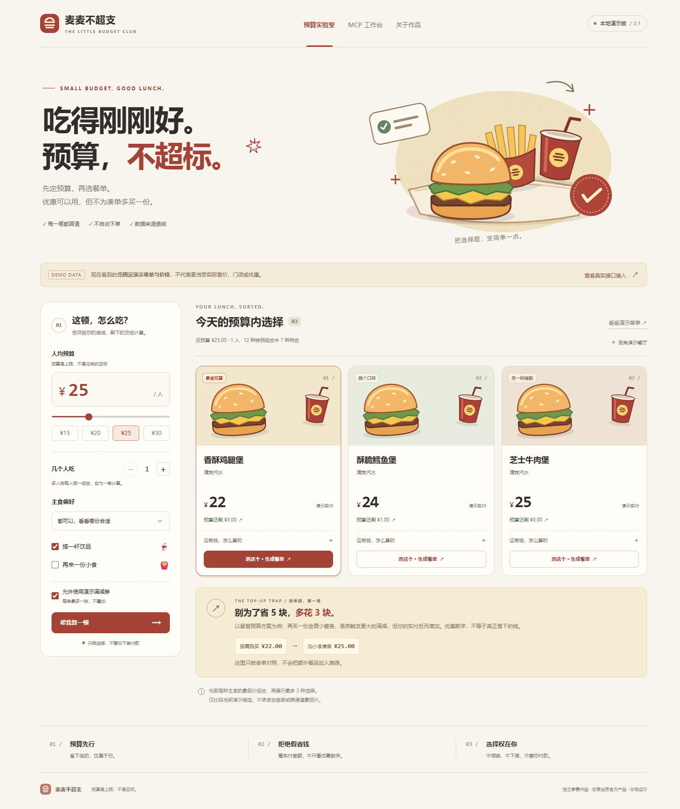
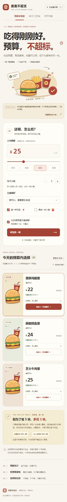
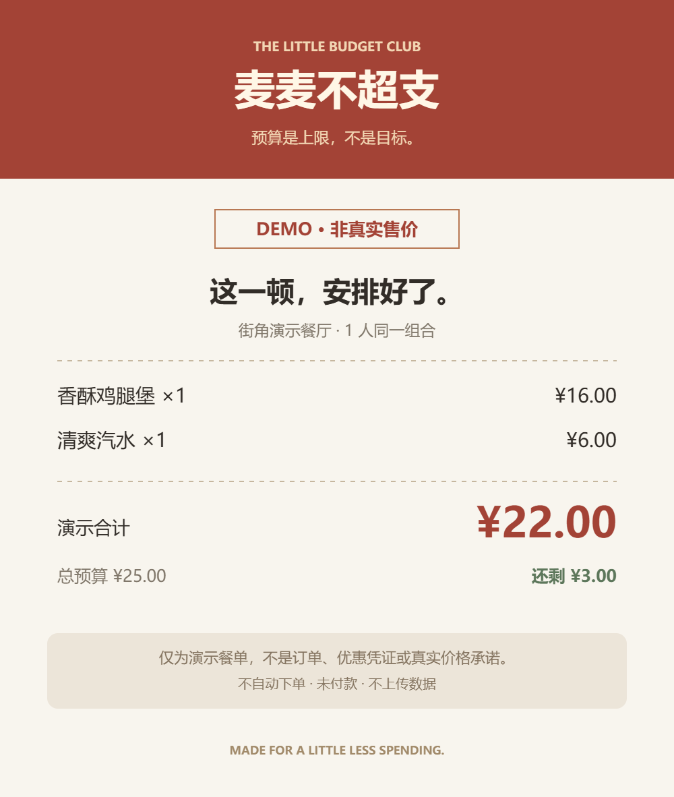
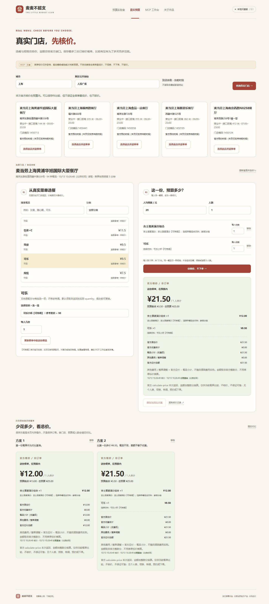
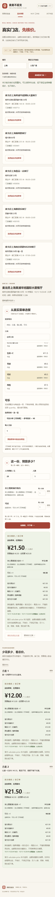
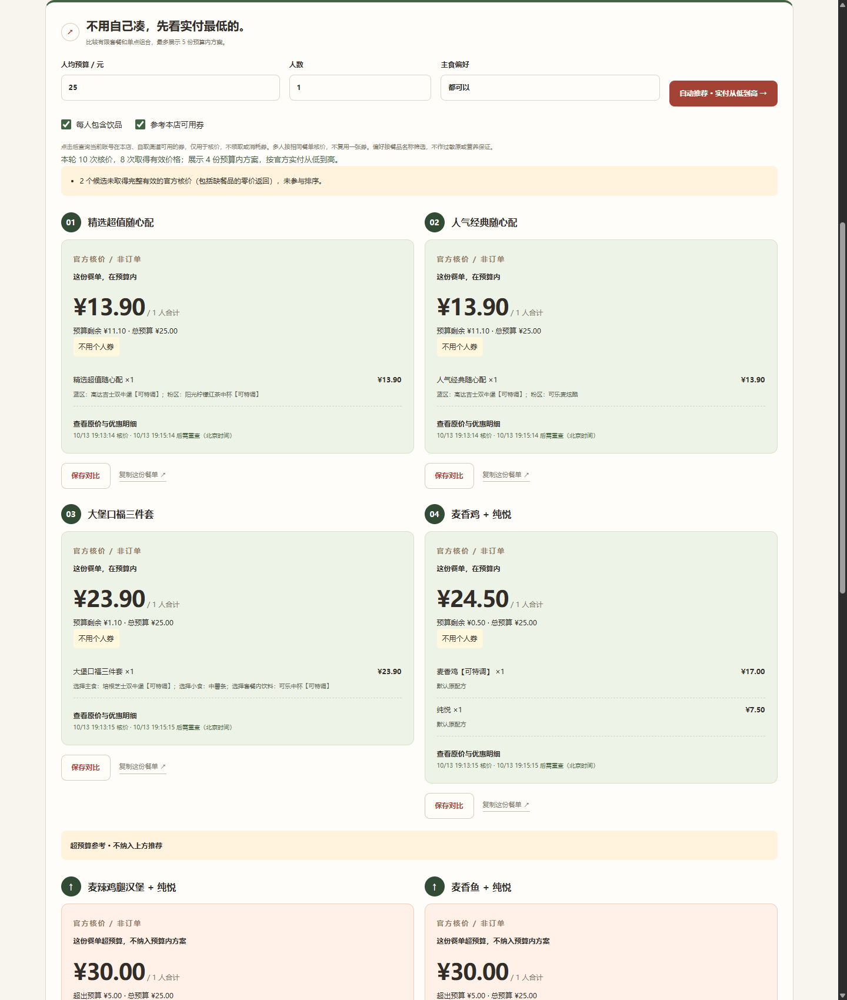
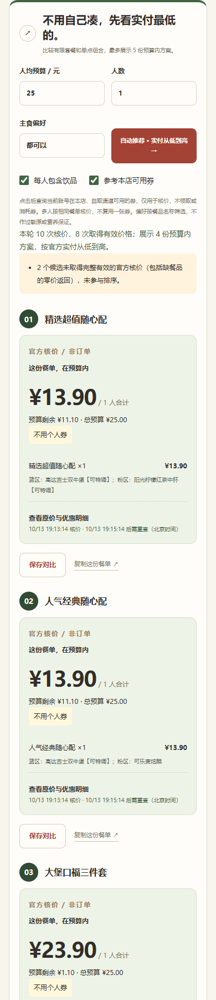

# 麦麦不超支 · mcd-budget

**预算是上限，不是消费目标。** 帮你比较预算内餐单、识别「凑单反而多花钱」的小工具与 Skill。

> **0.1.0 / 本地 MVP。** 「真实预算」通过官方 MCP 自动搭配餐单、参考本店可用券，按官方实付从低到高推荐；保留手动选餐与最多三份报价对比。「预算实验室」仍使用固定演示数据。2026-10-13 已完成上海人民广场附近一家门店的真实页面与券核价闭环，详见验证记录；仅比较有限候选，不保证全菜单最低价，也不表示已取得参赛资格。不下单、不领券、不支付、不抽奖、不兑换积分。

## 立即运行

需要 **Node.js 22 或以上**，零第三方运行依赖，**不用 npm install**。

从公开仓库获取项目：

```powershell
git clone https://github.com/FClannad/mcd-budget.git
cd mcd-budget
node src/server.mjs
```

本机已有项目时：

```powershell
cd D:\xm\mcd-budget
node src/server.mjs
```

打开 **http://127.0.0.1:3210**；真实预算入口为 **http://127.0.0.1:3210/#live**，需要本机配置 MCP Token。其他系统在项目目录运行同一条 Node 命令即可。

```powershell
npm.cmd start
npm.cmd test
npm.cmd run demo
npm.cmd run check
```

Windows 的 `npm.ps1` 被执行策略拦截时，用 `npm.cmd` 或直接运行 Node，不需要更改系统策略。

## 页面与验证

下面是**固定演示数据**的本地实测截图，不是官方实时点餐或已下单结果。



<details>
<summary>查看手机尺寸与导出演示餐单</summary>




</details>

已补齐 HTTP／CLI 与浏览器回归验证，并修复旧请求报错覆盖新结果的问题。测试范围、真实运行环境与未验证项见 [本地验证记录](docs/LOCAL_VALIDATION.md)。

<details>
<summary>查看真实预算页面：2026-10-13 10:26（北京时间）的历史核价，已过期</summary>




该次门店返回 94 种早餐时段餐品。吉士蛋麦满分组合（含鲜萃冰咖）官方核价 ¥12.00，另加小杯可乐后 ¥21.50；多付 ¥9.50 来自多买一杯饮料，不是节省或优惠。两份餐单只是开发验证，不是购买建议。不得把历史截图价格当成现在的售价，详情见 [真实联调记录](docs/LIVE_VALIDATION.md)。

</details>

<details>
<summary>查看自动推荐：2026-10-13 19:13（北京时间）的历史核价，已过期</summary>




该次晚间菜单有 113 种餐品。¥25/人、1 人、含饮品的已核价候选按 **¥13.90、¥13.90、¥23.90、¥24.50** 升序展示。两张本店咖啡券对应的整顿餐单分别为 ¥30.30、¥31.70，均超预算，不能因为有券就优先推荐。相同咖啡餐单的无券核价缺少餐品，已拒绝该结果，不编造「用了券省多少」。这不是当前价格或全菜单最低价，脱敏摘要见 [自动推荐证据](docs/evidence/recommend-20261013.json)。

</details>

## 为什么做这个

目标用户：有午餐预算、不愿反复比较券和餐品的学生与上班族。

自建样例中，汉堡 + 饮品 **22 元**；加 **8 元** 小食可用「满 30 减 5」，但实付变为 **25 元**。优惠 5 元，却比原需求 **多付 3 元**。我们把这两笔账放一起，不只展示优惠数字。

这些数字只是演示，不是麦当劳售价或真实节省统计。

## 当前功能

### 真实预算

- 明确输入城市和公共地标，主动选店后才读取当前菜单，不读收藏或个人地址。
- 设定预算、人数、主食偏好与是否含饮品，点击自动推荐；逐篮官方核价，最多展示 5 个预算内方案，按最终实付升序排列，另列最多 2 个超预算参考。
- 可选择参考当前账号在本店、自取渠道可用的券；精确匹配券对应餐品和规格，不领券、不读取全账户券包。用券与无券同一餐单均核价成功才展示增量节省。
- 券餐若比本轮最低方案更贵，明确显示多付多少，不把「有券」当作「最便宜」。一次候选至多一券；多人不复用数量未知的同一张券。
- 手动选单品或支持每组必选一项的套餐；只使用实际详情返回的规格，不猜商品编码。
- 官方逐份核价后判断人均预算 × 人数；显示餐品小计、优惠、整单调整与应付总额，不用菜单标价算实付。
- 本页内存保存最多三份核价作对比；餐品改变的差额不冒充优惠，不自动加餐。
- 菜单有效窗口 5 分钟，报价比较窗口 2 分钟；过期禁用相关操作，不静默刷新或锁价。
- 复制真实核价文本保留门店、来源、时间与非订单提示；真实报价尚不支持 PNG 导出。

### 离线演示与公共能力

- 人均预算 × 人数形成硬上限，金额全程使用整数分。
- 先取每种主食的最低样例实付组合，再展示最多三种；不以「花完预算」排序。
- 主食偏好、饮品、小食、演示满减券；每单最多一券，不叠加。
- 单独比较凑单的优惠增量与实付增量，不偷偷把额外餐品加入推荐。
- 预算无解时展示最低样例金额和缺口；只有用户点击才调整预算。
- 复制餐单或本地导出 PNG，保留演示水印，不上传数据。
- 只读 MCP 工作台 / CLI：JSON、SSE、会话、分页、动态参数 Schema、六工具白名单。
- 回环监听、CSRF、Host/Origin 校验、静态路径白名单；Token 不进网页。
- 根目录 [SKILL.md](SKILL.md)：指导智能体执行真实预算比较或离线演示。

### 明确未完成

全菜单穷举最省餐单、全部优惠券规则及叠加求解、多人券资产分配；逐人不同餐单、同一餐品多种规格、每组多选套餐、特调、外送与预约；活动报名及 WorkBuddy 开发记录。手动真实预算每人最多 8 种、共 12 份餐品，1–6 人共用同一组合。自动推荐有查询数量与时间上限，不保证所有餐品都可适配或参与核价。无健康、过敏原、全菜单或全渠道最低价保证。

## 数据路径

| 路径 | 来源与能力 | 状态 |
|---|---|---|
| 预算实验室 / `scripts/plan.mjs` | `data/demo.json` 固定样例，自动计算、对照、导出 | 现在可运行 |
| 真实预算 / `#live` | 官方当前菜单与规格、有限自动搭配、门店券参考、逐篮官方核价升序；另有手动选餐和对比 | 单店到店自取与两张券的核价已实测 |
| MCP 工作台 / `scripts/mcp.mjs` | 官方真实响应，按当前 Schema 手动发起六类只读调用 | 六类工具已发现；已验证门店、菜单、详情、门店券、核价五类 |
| `SKILL.md` 真实流程 | 指导智能体使用已有页面或建立有限候选，逐一官方核价并解释券前后差额 | 技能说明，未在 WorkBuddy 实测 |

MCP 失败不回退演示价格。样例优惠引擎拒绝 `source: "mcp"` 数据，避免把复杂真实规则套成简单满减。

## 接入真实 MCP

1. 用本人账号在 [官方 MCP 平台](https://open.mcd.cn/mcp) 申请 Token，先阅读并接受相应服务条款。
2. 复制 `.env.example` 为 `.env`，**仅在本机编辑** `MCD_MCP_TOKEN`。不要把凭证发到聊天中或提交到 Git。
3. 重启服务，打开「真实预算」，输入城市和公共地标，点击「查询真实门店」。页面不自动发起官方查询。
4. 选择营业门店，设置人均预算、人数、主食偏好和饮品要求；可取消「参考本店可用券」。点击「自动推荐 · 实付从低到高」，不会在页面加载时查券。
5. 查看已核价方案和对应券说明；无券基线失败时不展示虚构的节省额。自动推荐通常需要多次查询，触达限流时只展示已验证结果并提示，不自动重试。
6. 想自己搭配时，在下方手动选择餐品、确认规格并加入每人餐单，再点击「仅核价，不下单」；手动路径不套个人券。
7. 核价成功后可保存为对比方案或复制记录；改变条件会废弃相关旧结果，修改门店、预算或人数清空对比。过期后显式重新查询，不把旧价格当成有效报价。

需要查动态 Schema 或不支持的餐品字段时，再使用「MCP 工作台」。工作台展示原始响应，不会自动写入真实餐单；收到 JSON 不等于业务成功。

配置优先级：进程环境变量 > 根目录 `.env` > 默认端口 3210。仅读取 `MCD_MCP_TOKEN`、`PORT`。

```powershell
node scripts/mcp.mjs inspect
node scripts/mcp.mjs call query-meals --args .local/menu-args.json
```

`.local` 中的参数文件可能含门店/账户信息，不要公开。`mcp-config.example.json` 只含环境变量占位符；不同连接器的展开方式可能不同，须核对客户端文档。占位符不等于已有可用凭证。

本机已验证上海人民广场附近「麦当劳上海黄浦华旭国际大厦餐厅」的门店 → 当前菜单 → 规格／门店券 → 官方核价 → 升序推荐与页面比较。金额按官方整数分转换；失败或缺字段不回退演示值。实测范围和历史时间见 [真实联调记录](docs/LIVE_VALIDATION.md)，不代表其他门店、时段或套餐都已验证。

更多实现与边界见 [MCP_INTEGRATION.md](MCP_INTEGRATION.md)。

## 离线 CLI

```powershell
node scripts/plan.mjs --budget 25 --people 1 --drink
node scripts/plan.mjs --budget 25 --people 2 --drink --side --json
node scripts/plan.mjs --budget 10 --drink
node scripts/plan.mjs --budget 30 --main beef --no-coupons
```

CLI 只有传入 `--drink` 才含饮品；网页默认勾选。多人样例为每人同一组合、同一订单。

## 测试和发布检查

```powershell
node --test test/*.test.mjs
node scripts/check-release.mjs
# 可选：需要本机 Chrome / Chromium / Edge，不访问外部网页
npm.cmd run test:browser
# 额外检查真实联调记录状态；不是参赛资格认证
node scripts/check-release.mjs --submission
```

单元/HTTP 测试不调用真实 MCP；协议与真实适配测试使用明确标记的合成 fixture，不计作真实账号证据。三个浏览器脚本临时启动回环服务，强制不读取 Token，独立浏览器配置用完即清理；只产生演示或模拟截图，剪贴板使用测试替身，不改系统剪贴板。报告分别写入 `.local/browser-check/run-*/`、`.local/live-browser-check/run-*/`、`.local/recommend-browser-check/run-*/`，终端会给出本次目录。可通过 `CHROME_PATH` 指定本机浏览器。真实联调另行执行并记录，不混入默认离线测试。

## 目录

```text
public/                  中文页面、CSS、原创 SVG
src/planner.mjs           整数分预算求解与凑单比较
src/mcp.mjs               只读 Streamable HTTP 客户端
src/live.mjs              真实业务字段适配、菜单快照与官方核价
src/recommend.mjs         有限自动搭配、门店券精确匹配与实付升序
src/server.mjs            本地 HTTP 服务与请求保护
scripts/                 CLI、发布检查、浏览器测试
data/demo.json           固定演示数据
test/                    Node 内置测试
SKILL.md                 智能体技能
MCP_INTEGRATION.md       真实接口流程、金额映射与支持边界
CONTEST_DECLARATION.md   官方原版声明，不修改
docs/SUBMISSION.md       参赛清单与简介草稿
docs/LOCAL_VALIDATION.md 本地实际验证记录
docs/LIVE_VALIDATION.md  真实只读联调记录（历史结果，非实时价格）
docs/LIVE_VALIDATION.template.md  真实联调记录模板（非证据）
docs/evidence/           最小脱敏真实联调摘要
docs/screenshots/        已检查的演示截图与带日期的真实历史截图
docs/WORKBUDDY_HANDOFF.md 后续真实开发任务
docs/upstream/           官方文档快照与哈希
```

## 参赛前

代码已公开发布，尚未提交活动报名 Issue。2026-10-14 已重新核对官方现行规则，发布后的匿名克隆通过 167 项测试、50 项离线浏览器检查及本地发布检查；复现记录见 [本地验证](docs/LOCAL_VALIDATION.md)。请按 [清单](docs/SUBMISSION.md) 核对本人资格并使用已准备的正文报名，等待官方成功回复。真实实测已有有限范围的记录；新增能力继续按 [模板](docs/LIVE_VALIDATION.template.md) 如实补证。代码公开、原版声明和技术检查均不代表主办方已确认参赛资格。

没有伪造 `workbuddy.md`。需要专项奖励时，请实际使用 WorkBuddy 接手开发并导出真实上下文，见 [接手说明](docs/WORKBUDDY_HANDOFF.md)。

本项目为独立作品，非麦当劳或 WorkBuddy 官方产品。原创代码与插画使用 MIT 许可；官方规则、声明和品牌不受本项目 MIT 再授权，见 [第三方说明](THIRD_PARTY_NOTICES.md)。
